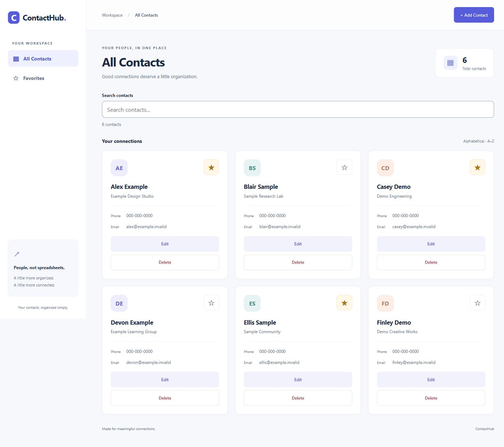
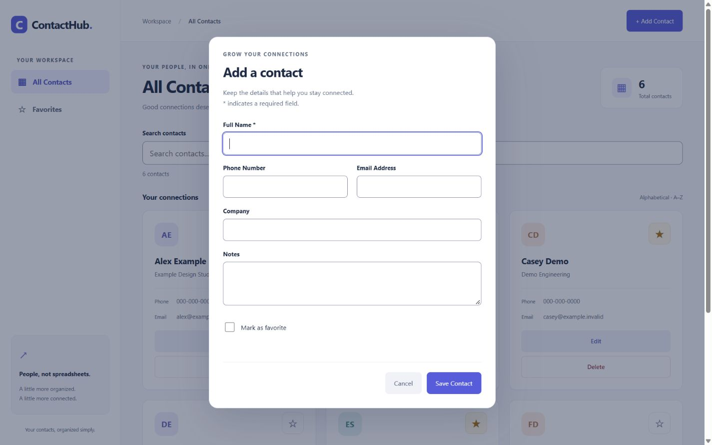
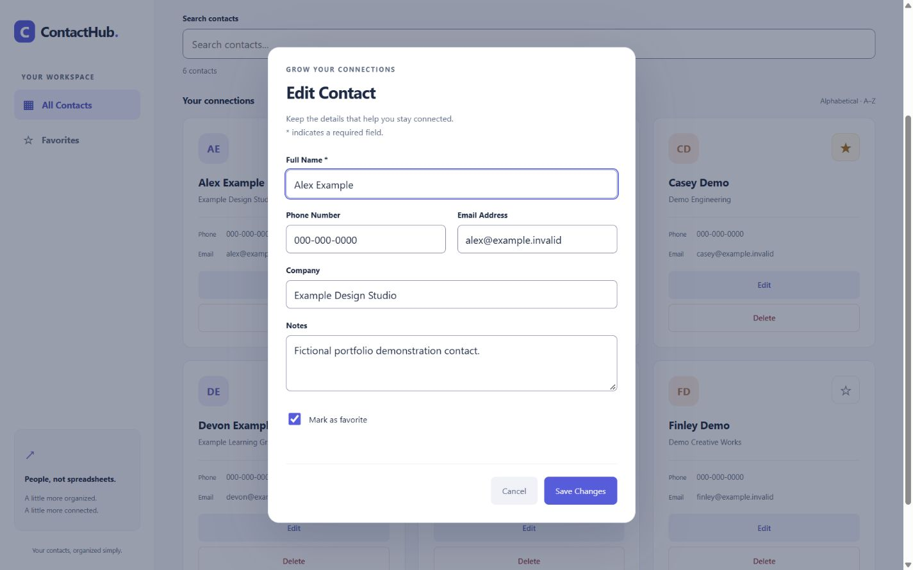
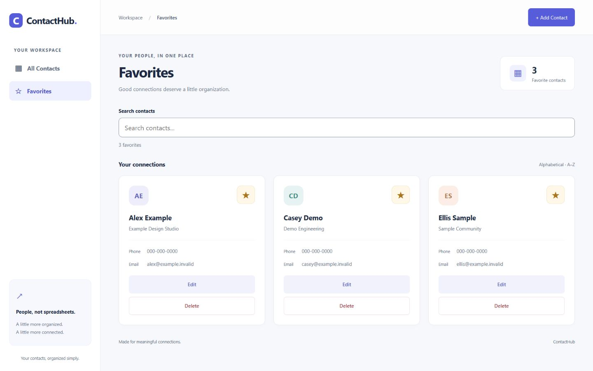
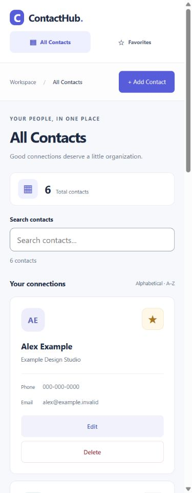

# ContactHub v1

**Your contacts, organized simply.**

ContactHub is a full-stack contact management application built with Flask, SQLite, and vanilla JavaScript. It lets you create, browse, edit, delete, search, and favorite personal or professional contacts through a responsive web interface.

**Status:** ContactHub v1 — core features implemented and verified for **local, single-user use**. No hosted deployment is included.

[Screenshots](#screenshots) · [Run locally](#run-locally-on-windows) · [Testing](#testing) · [REST API](#rest-api) · [Known limitations](#known-limitations)



## Implemented features

- **Contact CRUD:** create and edit labeled fields, browse alphabetical cards, and delete only after a named confirmation.
- **Persistent storage:** SQLite stores names, phone numbers, email addresses, companies, notes, favorites, and timestamps.
- **Backend-powered search:** partial matches across name, phone, email, and company, with a 300 ms frontend debounce and stale-response protection.
- **Favorites:** accessible star buttons, an All Contacts/Favorites view switch, and search within Favorites.
- **Responsive interaction:** desktop sidebar, compact mobile navigation, initials-based avatars, counts, and loading/empty/error/retry states.
- **Validation and reliability:** backend validation, parameterized SQL, safe DOM rendering, duplicate-request prevention, and separate messages for successful saves followed by failed refreshes.
- **Keyboard support:** labeled forms, native modal dialogs, visible focus, Escape/cancel behavior, unsaved-change confirmation, and focus restoration.

## Screenshots

These are real captures of the working Flask application, not mockups. All names and companies are fictional, email addresses use `example.invalid`, and phone numbers are placeholders. The screenshots used a separate disposable SQLite database; no personal contact data or demo database is included in the repository.

<details>
<summary>Add Contact dialog</summary>



</details>

<details>
<summary>Edit Contact dialog</summary>



</details>

<details>
<summary>Favorites view</summary>



</details>

<details>
<summary>Mobile dashboard</summary>



</details>

[Capture dimensions and provenance](docs/screenshots/README.md)

## Technology stack

| Layer | Technology |
|---|---|
| Frontend | HTML5, CSS3, vanilla JavaScript, Fetch API |
| Backend | Python 3, Flask |
| Database | SQLite through Python's built-in `sqlite3` module |
| Tests | pytest and Node.js's built-in test runner |
| Version control | Git and GitHub |

No frontend framework, npm packages, ORM, or external database service is required.

## Run locally on Windows

### 1. Install prerequisites

Install [Python for Windows](https://www.python.org/downloads/windows/), [Git for Windows](https://git-scm.com/install/windows), and a maintained [Node.js LTS release](https://nodejs.org/en/download). Node.js is needed only for JavaScript tests, not to run the app.

Open a new PowerShell window and check:

```powershell
py --version
git --version
node --version
```

This checkout was verified with Python 3.13.5 and Node.js 20.10.0. Those are verification versions, not a recommendation to install an older release; use maintained releases for a new setup.

### 2. Get the project

```powershell
git clone https://github.com/sharmayash0407-cloud/ContactHub.git
Set-Location ContactHub
```

If you already have the project, open PowerShell in its existing root folder instead. A private repository requires a GitHub account with access.

### 3. Create the virtual environment and install dependencies

```powershell
py -m venv .venv
.\.venv\Scripts\python.exe -m pip install -r backend\requirements.txt
```

Run environment creation once. Calling its Python directly avoids activation and PowerShell execution-policy changes. Dependencies are recorded in [backend/requirements.txt](backend/requirements.txt).

### 4. Start Flask

```powershell
.\.venv\Scripts\python.exe backend\app.py
```

Open [http://127.0.0.1:5000](http://127.0.0.1:5000) in your browser. Press **Ctrl+C** in PowerShell to stop the server.

The app automatically creates `backend/contacts.db` when it starts and preserves existing records. A fresh checkout starts empty; the screenshot contacts are not seeded into your application.

**Local use only:** the default server binds to `127.0.0.1` with debug mode off. There is no authentication or production hardening. Do not expose it publicly without appropriate security protections and a separate deployment review.

## Testing

From the repository root:

```powershell
.\.venv\Scripts\python.exe -m pytest -q
node --test tests/frontend.test.cjs
```

No `npm install` is needed. Tests use isolated SQLite databases and synthetic contact data rather than your development database. JavaScript tests use a small DOM stand-in; they do not replace actual browser inspection.

**Verified on 30 October 2026:** 129 Python tests and 132 JavaScript tests passed, with zero failures. Coverage includes CRUD/persistence, validation, SQL injection regressions, literal wildcard search, favorites filtering, stale responses, duplicate requests, errors, and retries.

The local v1 quality review also exercised a complete browser CRUD/search/favorites workflow and checked layouts at 1440×900, 768×1024, 390×844, and 320×568. This is not a formal accessibility certification. [Detailed verification notes](docs/DEVELOPMENT.md#local-v1-quality-review--30-october-2026) include the manual checks and remaining limits.

## REST API

All endpoint paths are relative to the local Flask server. Successful responses and errors use JSON.

| Method | Endpoint | Purpose | Success |
|---|---|---|---|
| GET | `/api/contacts` | List contacts | 200, `{"contacts": [...]}` |
| GET | `/api/contacts?search=QUERY` | Search name, phone, email, and company | 200, `{"contacts": [...]}` |
| GET | `/api/contacts?favorite=true` | List favorites; combines with `search` | 200, `{"contacts": [...]}` |
| GET | `/api/contacts/<id>` | Retrieve one contact | 200, `{"contact": {...}}` |
| POST | `/api/contacts` | Create a contact | 201, `{"contact": {...}}` |
| PUT | `/api/contacts/<id>` | Replace editable contact fields | 200, `{"contact": {...}}` |
| PATCH | `/api/contacts/<id>/favorite` | Set favorite status | 200, `{"contact": {...}}` |
| DELETE | `/api/contacts/<id>` | Permanently delete a contact | 200, `{"message": "Contact deleted."}` |

POST requires a nonblank name. PUT requires all six editable fields. Example JSON:

```json
{
  "name": "Alex Example",
  "phone": "000-000-0000",
  "email": "alex@example.invalid",
  "company": "Example Design Studio",
  "notes": "Fictional example contact.",
  "favorite": true
}
```

Send `Content-Type: application/json` for POST, PUT, and PATCH. Favorite PATCH accepts only `{"favorite": true}` or `{"favorite": false}`. IDs and UTC timestamps are generated by the backend.

Text limits: name/company 200, phone 50, email 254, notes 5000 characters. Optional text fields default to empty strings on creation; favorite defaults to false. Errors use `{"error": {"code": "...", "message": "..."}}`, with 400, 404, 405, 415, or 500 as appropriate.

Search treats `%` and `_` literally. `favorite=true` filters favorites; `favorite=false` or omission means all contacts. Invalid or repeated search/favorite parameters are rejected where documented in the [development guide](docs/DEVELOPMENT.md#favorites). The frontend displays alphabetical results; the original unfiltered API retains ID order.

## Project structure

```text
ContactHub/
├── frontend/              # Dashboard, styles, API requests, DOM rendering
│   ├── index.html
│   ├── css/style.css
│   └── js/
│       ├── api.js
│       └── app.js
├── backend/               # Flask routes, SQLite connections, contact model
│   ├── app.py
│   ├── database.py
│   ├── models.py
│   └── requirements.txt
├── tests/                 # Python integration and JavaScript regression tests
├── docs/
│   ├── DEVELOPMENT.md     # Implementation details and local v1 review
│   └── screenshots/       # Real UI captures using fictional contacts
├── .gitignore
└── README.md
```

Virtual environments, generated databases, caches, and secret files remain excluded from Git.

## Known limitations

- Local single-user app; no authentication, public deployment, or concurrent-edit conflict detection.
- Search case-insensitivity is limited to ASCII. Phone searches match stored formatting.
- No undo for deletion. Interrupted responses can leave mutation outcomes uncertain; the UI explains when to reload before retrying.
- Unsaved form data and selected views/search reset on page reload; contacts and favorite status persist.
- No pagination, automatic polling, or large-dataset performance verification.
- Spoken screen-reader output, other browser engines, physical mobile devices, and high zoom remain additional manual checks.

Possible future work includes those manual checks and small improvements based on reproducible findings. No unimplemented feature is presented as part of v1.

## Development context

This is an incremental full-stack learning project developed with Codex assistance. The implementation and verification record is retained in the [development guide](docs/DEVELOPMENT.md). The project does not claim unaided authorship, production deployment, or formal accessibility certification.

## License decision pending

No project license file is currently present. **No license has been selected or added.**

- **MIT:** permits reuse, modification, redistribution, and commercial use, while requiring preservation of its copyright and permission notices. It also includes warranty/liability disclaimers. See the [MIT license terms](https://opensource.org/license/mit).
- **Without a license:** default copyright restrictions apply; publishing source does not grant general permission to reuse or redistribute it. GitHub's terms still permit viewing and forking a public repository. See [GitHub's licensing guidance](https://docs.github.com/en/repositories/managing-your-repositorys-settings-and-features/customizing-your-repository/licensing-a-repository).

The repository owner's approval is required before adding a license. Dependencies retain their own separate licenses.
