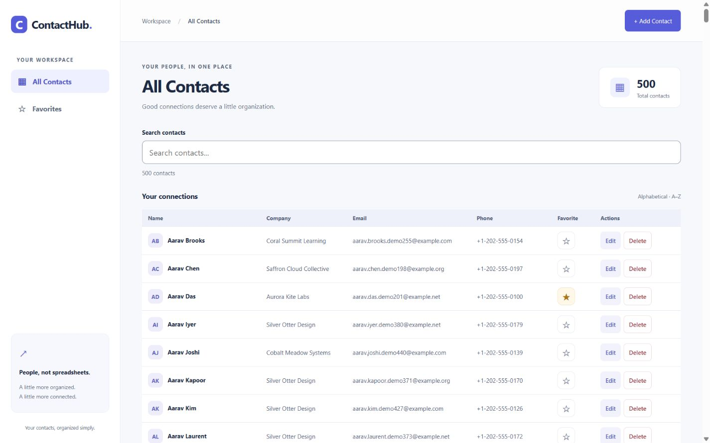
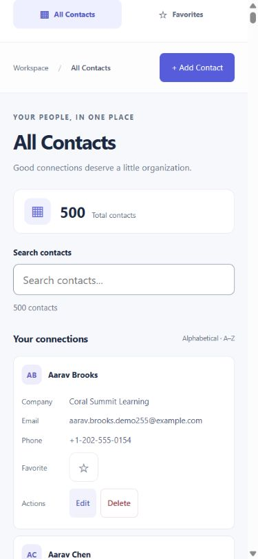

# ContactHub v1

**Your contacts, organized simply.**

ContactHub is a full-stack contact management application built with Flask, SQLite, and vanilla JavaScript. It lets you create, browse, edit, delete, search, and favorite personal or professional contacts through a responsive web interface.

**Status:** ContactHub v1 — core features implemented and verified for **local, single-user use**. No hosted deployment is included.

[Screenshots](#screenshots) · [Run locally](#run-locally-on-windows) · [Testing](#testing) · [REST API](#rest-api) · [Known limitations](#known-limitations)


## Implemented features

- **Contact CRUD:** create and edit labeled fields, browse alphabetical rows, and delete only after a named confirmation.
- **Persistent storage:** SQLite stores names, phone numbers, email addresses, companies, notes, favorites, and timestamps.
- **Backend-powered search:** partial matches across name, phone, email, and company, with a 300 ms frontend debounce and stale-response protection.
- **Favorites:** accessible star buttons, an All Contacts/Favorites view switch, and search within Favorites.
- **Responsive interaction:** desktop sidebar, compact mobile navigation, initials-based avatars, counts, and loading/empty/error/retry states.
- **Validation and reliability:** backend validation, parameterized SQL, safe DOM rendering, duplicate-request prevention, and separate messages for successful saves followed by failed refreshes.
- **Keyboard support:** labeled forms, native modal dialogs, visible focus, Escape/cancel behavior, unsaved-change confirmation, and focus restoration.

## Screenshots

The v1.1 table milestone replaces desktop cards with a semantic table (Name, Company, Email, Phone, Location, Favorite, Actions). At widths up to 1100px the same rows stack with field labels and touch-friendly actions; no duplicate mobile data or requests are used. Existing CRUD, search, favorites, dialogs and status handling remain intact. Server-side pagination now loads 25 contacts by default, with a 50-contact option. Field-specific search and server-side sorting are available in the search toolbar.





The gallery below preserves the original v1 card interface and dialogs for historical context.

These are real captures of the working Flask application, not mockups. All names and companies are fictional, email addresses use `example.invalid`, and phone numbers are placeholders. The screenshots used a separate disposable SQLite database; no personal contact data or demo database is included in the repository.

<details>
<summary>Add Contact dialog</summary>


</details>

<details>
<summary>Edit Contact dialog</summary>


</details>

<details>
<summary>Favorites view</summary>


</details>

<details>
<summary>Mobile dashboard</summary>


</details>

[Capture dimensions and provenance](docs/screenshots/README.md)

## Technology stack

| Layer | Technology |
|---|---|
| Frontend | HTML5, CSS3, vanilla JavaScript, Fetch API |
| Backend | Python 3, Flask |
| Database | SQLite through Python's built-in `sqlite3` module |
| Tests | pytest and Node.js's built-in test runner |
| Version control | Git and GitHub |

No frontend framework, npm packages, ORM, or external database service is required.

## Run locally on Windows

### 1. Install prerequisites

Install [Python for Windows](https://www.python.org/downloads/windows/), [Git for Windows](https://git-scm.com/install/windows), and a maintained [Node.js LTS release](https://nodejs.org/en/download). Node.js is needed only for JavaScript tests, not to run the app.

Open a new PowerShell window and check:

```powershell
py --version
git --version
node --version
```

This checkout was verified with Python 3.13.5 and Node.js 20.10.0. Those are verification versions, not a recommendation to install an older release; use maintained releases for a new setup.

### 2. Get the project

```powershell
git clone https://github.com/sharmayash0407-cloud/ContactHub.git
Set-Location ContactHub
```

If you already have the project, open PowerShell in its existing root folder instead. A private repository requires a GitHub account with access.

### 3. Create the virtual environment and install dependencies

```powershell
py -m venv .venv
.\.venv\Scripts\python.exe -m pip install -r backend\requirements.txt
```

Run environment creation once. Calling its Python directly avoids activation and PowerShell execution-policy changes. Dependencies are recorded in [backend/requirements.txt](backend/requirements.txt).

### 4. Start Flask

```powershell
.\.venv\Scripts\python.exe backend\app.py
```

Open [http://127.0.0.1:5000](http://127.0.0.1:5000) in your browser. Press **Ctrl+C** in PowerShell to stop the server.

The app automatically creates `backend/contacts.db` when it starts and preserves existing records. A fresh checkout starts empty; the screenshot contacts are not seeded into your application.

**Local use only:** the default server binds to `127.0.0.1` with debug mode off. There is no authentication or production hardening. Do not expose it publicly without appropriate security protections and a separate deployment review.

## Testing

From the repository root:

```powershell
.\.venv\Scripts\python.exe -m pytest -q
node --test tests/frontend.test.cjs
```

No `npm install` is needed. Tests use isolated SQLite databases and synthetic contact data rather than your development database. JavaScript tests use a small DOM stand-in; they do not replace actual browser inspection.

**Verified on 30 October 2026:** 129 Python tests and 132 JavaScript tests passed, with zero failures. Coverage includes CRUD/persistence, validation, SQL injection regressions, literal wildcard search, favorites filtering, stale responses, duplicate requests, errors, and retries.

The local v1 quality review also exercised a complete browser CRUD/search/favorites workflow and checked layouts at 1440×900, 768×1024, 390×844, and 320×568. This is not a formal accessibility certification. [Detailed verification notes](docs/DEVELOPMENT.md#local-v1-quality-review--30-october-2026) include the manual checks and remaining limits.

## REST API

### Optional city and locality

Add/Edit forms accept **City (optional)** (100 characters) and **Locality (optional)** (200 characters). Strings are trimmed; explicit null, non-string and oversized inputs return HTTP 400. Both fields are searchable globally and via `field=city` / `field=locality`, together with favorites, sort and pagination. Location is displayed as “Locality, City” in one compact column, or “Not provided” if both are blank. No location-specific sort options were added.

POST defaults omitted location fields to empty strings. PUT still requires the original six editable fields, while omitted city/locality preserve the record's current location for older clients. Send `"city": ""` and `"locality": ""` to clear them. Responses include both fields as strings, with database NULL normalized to `""`; the existing contacts/contact/pagination envelopes are unchanged.

Existing databases are upgraded at startup using fixed-name, nullable `ALTER TABLE ... ADD COLUMN ... TEXT` statements guarded by `PRAGMA table_info`. The migration is idempotent and also runs for fresh installations. It never rebuilds the contact table or changes existing IDs, favorites or timestamps. Back up your local SQLite database before upgrading; keep the backup ignored and stop editing while upgrading. This milestone verified a SQLite backup, tested migration twice on a copy, then migrated the development database and compared all original fields across all 501 records. Backups remain local under `backend/backups/`; none are tracked.

On 31 October 2026, **210 Python tests and 151 JavaScript tests passed** alongside browser checks using a disposable 500-contact database plus one fictional location fixture. Checks included add/edit/clear, city/locality search, favorites, pagination, long values and all four supported viewport sizes. No horizontal overflow or console errors were observed. The stored development records only gained NULL columns; no real location details were collected or populated. The older screenshots below predate this Location column.

### Field-specific search and sorting

Select **Search in**: `all` (default), `name`, `phone`, `email`, `company`, `city`, or `locality`. Partial search remains case-insensitive for ASCII and treats `%`, `_`, and the escape character literally. Changing fields applies the existing query to that field and resets page 1; Clear search clears only the text and retains field, sort and favorites selections.

Select **Sort contacts**:

| API value | Order |
|---|---|
| `name_asc` (dashboard default) | Name A–Z, then ID ascending |
| `name_desc` | Name Z–A, then ID ascending |
| `company_asc` | Company A–Z, missing companies last; then name and ID ascending |
| `newest` | Creation timestamp descending, then ID descending |
| `oldest` | Creation timestamp ascending, then ID ascending |

```text
GET /api/contacts?search=tech&field=company&sort=name_desc&favorite=true&page=2&page_size=25
```

Flask validates `field` and `sort` against fixed allowlists and rejects invalid, empty, or repeated values with JSON HTTP 400 errors. SQLite applies field search and favorites consistently to both COUNT and page queries, with sorting before LIMIT/OFFSET. SQL column names and ORDER BY fragments come only from fixed mappings; search values remain bound parameters. Pagination metadata and contact response fields are unchanged.

Sort/field changes reset to page 1 and preserve the search text and favorites view. Pagination, page size, refresh after mutations, and retry retain the selections. Debounce and stale-response protection remain active. A contact can move off the current page after creation/editing or disappear from filtered results after unfavoriting/deletion. Selections reset on a full page reload.

Compatibility: a plain unpaginated request without `sort` retains its historical ID order. Filtered or paginated requests default to name A–Z. Specify `sort=name_asc` for explicit alphabetical order on an unpaginated request. Newest/oldest use existing stored timestamps; no schema changes were made.

Verified on 31 October 2026: **190 Python and 145 JavaScript tests passed**. Browser checks used 500 isolated synthetic contacts across 1440×900, 768×1024, 390×844 and 320×568, including sort changes from later pages, combined company search/favorites, page-size selection and native keyboard access. No horizontal overflow or console errors were observed. Browser mutations were not repeated for this milestone; automated tests verify mutation ordering and retained selections. Spoken screen-reader output and other browser engines remain unverified.

### Server-side pagination

The dashboard requests `GET /api/contacts?page=1&page_size=25`. Previous/Next controls fetch only the requested rows; the summary uses the total matching count from Flask. Choose 25 (default) or 50 (maximum) contacts per page. Changing search, favorites view or page size resets to page 1. Retrying keeps the requested page and filters. Saves refresh the current view; renamed records may move between pages, and deletion/unfavoriting clamps the view to the last valid page when necessary.

Pagination is opt-in for API callers: omitting both `page` and `page_size` preserves the original `{"contacts": [...]}` response. Supplying either enables pagination (`page` defaults to 1, `page_size` to 25). Values must be supplied once as positive ASCII decimal integers without spaces, signs or leading zeros; `page` supports up to 10 digits and `page_size` accepts only 25 or 50. Invalid values return HTTP 400 with the existing JSON error format.

Example request combining filters:

```text
GET /api/contacts?page=2&page_size=25&search=rahul&favorite=true
```

Example metadata shape (contact objects retain the existing fields):

```json
{
  "contacts": [],
  "pagination": {"page": 1, "page_size": 25, "total": 0, "total_pages": 0}
}
```

Empty matches return page 1, zero pages and an empty list; the UI shows “Page 0 of 0” and “Showing 0–0 of 0 contacts”. Requests above the final page return the final valid page, reported in metadata. SQL applies identical search/favorite conditions to COUNT and the page query in one read snapshot. Rows use `ORDER BY name COLLATE NOCASE, id LIMIT ? OFFSET ?`; OFFSET is `(page - 1) * page_size`. The original unpaginated ordering is preserved. Search still treats SQL wildcards literally.

Pagination verified on 31 October 2026: 163 Python and 141 JavaScript tests passed. Browser checks used 500 isolated synthetic contacts at 1440×900, 768×1024, 390×844 and 320×568; 25/50 rendered rows, navigation, final-page boundaries, global search, combined favorites, keyboard controls and no horizontal overflow were verified. No console errors were observed. Single local HTTP-plus-JSON samples were 90.77 ms (first 25 rows), 9.21 ms (second 50-row page) and 6.77 ms (combined search/favorites); these are not benchmarks. Render timing, physical devices and spoken screen-reader output remain unverified. Offset pagination can become costly on much larger datasets; no indexing/virtualization changes were added.

All endpoint paths are relative to the local Flask server. Successful responses and errors use JSON.

| Method | Endpoint | Purpose | Success |
|---|---|---|---|
| GET | `/api/contacts` | List contacts | 200, `{"contacts": [...]}` |
| GET | `/api/contacts?search=QUERY` | Search name, phone, email, and company | 200, `{"contacts": [...]}` |
| GET | `/api/contacts?favorite=true` | List favorites; combines with `search` | 200, `{"contacts": [...]}` |
| GET | `/api/contacts/<id>` | Retrieve one contact | 200, `{"contact": {...}}` |
| POST | `/api/contacts` | Create a contact | 201, `{"contact": {...}}` |
| PUT | `/api/contacts/<id>` | Replace editable contact fields | 200, `{"contact": {...}}` |
| PATCH | `/api/contacts/<id>/favorite` | Set favorite status | 200, `{"contact": {...}}` |
| DELETE | `/api/contacts/<id>` | Permanently delete a contact | 200, `{"message": "Contact deleted."}` |

POST requires a nonblank name. PUT requires the original six editable fields; city and locality are optional. Example JSON:

```json
{
  "name": "Alex Example",
  "phone": "000-000-0000",
  "email": "alex@example.invalid",
  "company": "Example Design Studio",
  "notes": "Fictional example contact.",
  "favorite": true
}
```

Send `Content-Type: application/json` for POST, PUT, and PATCH. Favorite PATCH accepts only `{"favorite": true}` or `{"favorite": false}`. IDs and UTC timestamps are generated by the backend.

Text limits: name/company 200, phone 50, email 254, notes 5000, city 100, locality 200 characters. Optional text fields default to empty strings on creation; favorite defaults to false. Errors use `{"error": {"code": "...", "message": "..."}}`, with 400, 404, 405, 415, or 500 as appropriate.

Search treats `%` and `_` literally. `favorite=true` filters favorites; `favorite=false` or omission means all contacts. Invalid or repeated search/favorite parameters are rejected where documented in the [development guide](docs/DEVELOPMENT.md#favorites). The frontend displays alphabetical results; the original unfiltered API retains ID order.

## Project structure

```text
ContactHub/
├── frontend/              # Dashboard, styles, API requests, DOM rendering
│   ├── index.html
│   ├── css/style.css
│   └── js/
│       ├── api.js
│       └── app.js
├── backend/               # Flask routes, SQLite connections, contact model
│   ├── app.py
│   ├── database.py
│   ├── models.py
│   └── requirements.txt
├── tests/                 # Python integration and JavaScript regression tests
├── docs/
│   ├── DEVELOPMENT.md     # Implementation details and local v1 review
│   └── screenshots/       # Real UI captures using fictional contacts
├── .gitignore
└── README.md
```

Virtual environments, generated databases, caches, and secret files remain excluded from Git.

## Known limitations

- Local single-user app; no authentication, public deployment, or concurrent-edit conflict detection.
- Search case-insensitivity is limited to ASCII. Phone searches match stored formatting.
- No undo for deletion. Interrupted responses can leave mutation outcomes uncertain; the UI explains when to reload before retrying.
- Unsaved form data and selected views/search reset on page reload; contacts and favorite status persist.
- No automatic polling. The table has been manually checked with 500 synthetic records; larger datasets and sustained performance benchmarks remain unverified.
- Spoken screen-reader output, other browser engines, physical mobile devices, and high zoom remain additional manual checks.

Possible future work includes those manual checks and small improvements based on reproducible findings. No unimplemented feature is presented as part of v1.

## Development context

This is an incremental full-stack learning project developed with Codex assistance. The implementation and verification record is retained in the [development guide](docs/DEVELOPMENT.md). The project does not claim unaided authorship, production deployment, or formal accessibility certification.

## License decision pending

No project license file is currently present. **No license has been selected or added.**

- **MIT:** permits reuse, modification, redistribution, and commercial use, while requiring preservation of its copyright and permission notices. It also includes warranty/liability disclaimers. See the [MIT license terms](https://opensource.org/license/mit).
- **Without a license:** default copyright restrictions apply; publishing source does not grant general permission to reuse or redistribute it. GitHub's terms still permit viewing and forking a public repository. See [GitHub's licensing guidance](https://docs.github.com/en/repositories/managing-your-repositorys-settings-and-features/customizing-your-repository/licensing-a-repository).

The repository owner's approval is required before adding a license. Dependencies retain their own separate licenses.

## Optional development demo data

The development-only [seed script](scripts/seed_contacts.py) generates exactly 500 fictional contacts using random seed `20261030`. From the project root:

```powershell
# Read-only preview (database must already exist):
.\.venv\Scripts\python.exe scripts\seed_contacts.py
# Explicitly back up and add 500 records:
.\.venv\Scripts\python.exe scripts\seed_contacts.py --apply
```

Start the app once to initialize a fresh database before seeding. Close other editing sessions during import. The script preserves existing contacts, validates generated data using Flask's existing validator, inserts with parameterized SQL in one transaction, and verifies a SQLite backup before inserting. Backups are timestamped `.db` files under `backend/backups/`; both databases and backups are ignored by Git. `--database PATH` targets another existing local database for testing.

Each record has a unique `[contacthub-seed-v1:NNN]` notes marker. If any marker already exists, both preview and apply refuse the operation, including after a partial dataset has been manually deleted. Do not remove the markers or rerun against the same data to create another batch. To repeat a clean demonstration, use a separate initialized test database. There is no automatic reset or deletion command.

Names combine Indian and international name components; all identities and companies are fictional. Emails use example.com/org/net, phone values use the fictional North American `202-555-0100`–`0199` range (reused across records), 90 contacts are favorites (18%), and some phone/email/company fields are blank. Notes always retain the provenance marker. No external data or additional packages are used.
